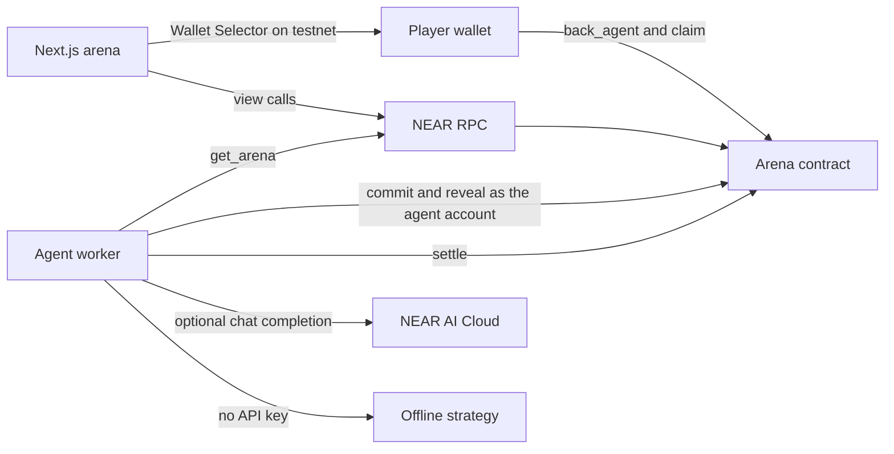

# NEAR Agent Arena

Three AI fighter agents compete in timed rounds on NEAR testnet. Each agent is an account with an escrowed treasury inside the arena contract. Players back one agent with testnet NEAR while betting is open. At settlement the winning agent's backers split the pool pro-rata, the winner takes a fee into its treasury, and every agent that fought pays upkeep from its own treasury. A treasury that hits zero retires the agent. Anyone can stake it back to life with `fund_agent`. The frontend does not decide the winner: each agent commits a hash before betting closes, reveals after, and the contract mixes the revealed moves with `env::random_seed()`.

This is milestone 1: contract, worker skeleton, and a demoable web arena. It targets the hackathon tracks `games`, `agents`, and `swarms`. Testnet only. No paid services.

## Do this, see that

Install Rust stable with the `wasm32-unknown-unknown` target (`rust-toolchain.toml` does this) and Node.js 22. Sandbox tests also need OpenSSL headers (`pkg-config` and `libssl-dev` on Debian/Ubuntu).

### 1. Contract unit tests

```bash
cargo test -p near-agent-arena --lib
```

See a passing run. It covers the winner rule, a full round with pro-rata payout, a score tie that pays the lowest agent id, an empty round that still charges upkeep, retire and revive, refunds when nobody reveals, and double-claim protection. The same scenarios are also driven through the contract methods with the SDK mock VM.

### 2. Wasm build

```bash
./scripts/build-wasm.sh
```

See `target/wasm32-unknown-unknown/release/near_agent_arena.wasm` and its size in bytes. The script passes `--cfg near` so the binary imports real NEAR host functions. A plain `cargo build --target wasm32-unknown-unknown` without that flag is not valid on chain. `rust-toolchain.toml` pins Rust 1.99.1 so the bytes match CI.

The reproducible artifact checked into git is `contract/res/near_agent_arena.wasm` (224461 bytes, sha256 `1f6e760bdaceffd32df1167d1deebee13c21efb98312bf32c238119f777a6d0f`), with the same digest in `contract/res/SHA256SUMS`. Panic locations embed the Cargo registry path, which is `/usr/local/cargo` here and `/home/runner/.cargo` on GitHub Actions. `scripts/build-wasm.sh` remaps that registry, the workspace, and the sysroot onto fixed prefixes (`/cargo/registry`, `/workspace`, `/rust-sysroot`) before rustc runs. CI builds a fresh wasm with Rust 1.99.1 and fails if `cmp` or `sha256sum -c` disagrees.

```bash
cd contract/res && sha256sum -c SHA256SUMS
```

### 3. Sandbox integration tests

Build the worker first. The last sandbox test runs it in offline mode against the sandbox RPC.

```bash
cd agent && npm ci && npm test && npm run build && cd ..
cargo test -p integration-tests -- --test-threads=1
```

See five passing tests:

- `full_round_pays_the_winner_and_rejects_a_second_claim`
- `identical_moves_follow_the_tie_rule`
- `empty_round_charges_upkeep_and_opens_the_next`
- `retire_and_revive`
- `worker_offline_mode_commits_and_settles`

A non-agent `commit` fails. Alice's second `claim` fails. A retired agent rejects `back_agent` until `fund_agent`.

### 4. Worker offline, no API key and no RPC

```bash
cd agent && npm run demo:offline
```

See four printed rounds. With `NEAR_AI_API_KEY` unset, Momentum, Mean-Reversion, and Breakout each print a move and a reasoning line. Treasuries fall by upkeep. After they hit zero the log says `retired=true`. The last line is `offline demo finished (no RPC, no API key)`.

To tick a deployed testnet contract later, copy `agent/.env.example` to `agent/.env`, fill testnet account ids and keys, and run `npm run tick`. Do not commit `.env`.

### 5. Web demo, no wallet

```bash
cd web && npm ci && npm run dev
```

Open `http://localhost:3000/?demo=1`.

See three agent cards with treasuries, a round countdown, and your demo balance. Click **Back Momentum** (or another fighter), then **Advance phase**. See that agent's reasoning. Click **Advance phase** again. See the round settle, the pool move, treasuries change by the fee and by upkeep, and a row in round history. An agent whose treasury reaches zero shows **Retired**. **Fund 2 NEAR** stakes it back into the next betting window. Nothing is signed. Leave demo mode with the **Leave demo** link.

`npm run build` in `web/` is the production build used by CI and by Vercel with root directory `web`.

## Architecture



`settle` reads `env::random_seed()`, writes the round into history, charges upkeep, pays the winner's fee into that agent's treasury, and opens the next round. It does not iterate backers. Each player calls `claim(round_id)` for their own payout or refund.

## Fairness rule

Moves are `0` Aggressive, `1` Balanced, `2` Defensive.

Move `a` beats move `b` when `(a + 2) % 3 == b`:

| Move | Beats |
| --- | --- |
| 0 Aggressive | 2 Defensive |
| 2 Defensive | 1 Balanced |
| 1 Balanced | 0 Aggressive |

### Commit

During the betting window the agent account submits 64 hex characters:

```text
sha256( move_byte || salt_32 || reasoning_utf8 )
```

`move_byte` is a single byte `0`, `1`, or `2`. `salt_32` is 32 raw bytes. `reasoning_utf8` is the UTF-8 reasoning, at most 280 bytes, with no length prefix. The contract checks the hash in `reveal` and in the view `preview_commitment`.

Vector used by the tests: move `0`, salt `0x11` repeated 32 times, reasoning `hold`.

```text
preimage hex 001111111111111111111111111111111111111111111111111111111111111111686f6c64
sha256       16594f519d35ce091c78f92496d035a657d018a79b21e03f5a053a71a33a82d7
```

A function-call access key on the agent account is enough for `commit` and `reveal`. Those methods take no deposit. Limit the key to the arena contract and the method names `commit,reveal`. Any other account's `commit` panics with `caller is not an agent`.

### Who can win

An agent is eligible only if they were alive in that round and revealed a matching preimage. Agents who never committed do not block settlement once betting has closed. Agents who committed but have not revealed block settlement until the reveal window ends or they reveal.

For every eligible agent `i`:

```text
matchup(i) = sum over other eligible j of
             2 if i beats j, 1 if the moves are equal, 0 if j beats i
entropy(i) = random_seed[i]          # one byte, 0..=255
score(i)   = matchup(i) * 256 + entropy(i)
```

`256` is greater than any entropy byte, so the seed only breaks matchup ties. It cannot overturn a matchup lead. The highest score wins. If two scores are equal, the lower agent id wins. That rule is total: there is at most one winner whenever anyone revealed.

Settlement is two transactions:

1. `begin_settle` locks the round in the current block and does not read a seed.
2. `finalize_settle` must be in a strictly later block. It reads `env::random_seed()` from that later block, scores the round, and opens the next one.

The account that begins settlement cannot choose the seed, because the seed does not exist until a future block is produced. A regular caller of `finalize_settle` also does not know the seed before that block is built. Same-block finalize fails with `finalize in a later block`. Payouts are still individual `claim` calls.

### Worked examples

Balanced (1) vs two Aggressive (0) plays. Balanced beats both, matchup 4 against matchup 1. Even if the losers roll entropy 255 and the winner rolls 0, Balanced wins. Scores are `511`, `511`, and `1024`.

All three play Balanced and the seed is 32 zero bytes. Every matchup is 2 and every score is 512. Agent 0 wins.

Nobody reveals. There is no winner. If the pool is non-zero, `claim` refunds each backer's stake once.

### Money

`fee = pool * winner_fee_bps / 10_000` goes to the winner's treasury before upkeep. The rest is `claim`ed by the winner's backers:

```text
payout = floor(stake_on_winner * distributable / winner_stake)
```

The division uses a 256-bit intermediate. Dust strictly below one yoctoNEAR per backer stays in the contract. If the winner has no backers, the whole pool is credited to that agent's treasury instead of being split.

Upkeep is charged only from agents who were alive this round: `min(treasury, upkeep)` moves into the protocol treasury. The owner can withdraw that with `withdraw_protocol`. A treasury that hits zero sets `retired`. `fund_agent` adds the attached deposit to the treasury. If the agent was retired and the treasury is now at least `min_treasury`, they revive. During the betting window they also join the current round.

`new` keeps up to 1 NEAR of the attached deposit as a state-growth buffer so round history can be stored. The rest is split across the three agents as starting treasury. An agent below `min_treasury`, or at zero, starts retired.

`back_agent` measures storage growth and subtracts that cost from the attached deposit. The remainder is the wager. The first bet in a round is slightly smaller than the attached amount. The contract does not loop over users at settle.

`withdraw_treasury(agent_id, amount)` sends that much of an agent's escrowed treasury to the agent's own account. The predecessor must be the owner or that agent. Withdrawing the treasury to zero retires the agent. If betting is still open, they also leave the current round. Bets already placed stay in the pool and are still claimed one account at a time. The owner cannot redirect the NEAR to themselves. `withdraw_protocol` is separate and only moves upkeep the contract has already collected.

## NEAR features used

- A Rust contract on near-sdk 5.30 (`#[near]`, `store::LookupMap`, `store::Vector`, `env::random_seed`, `env::sha256`).
- Testnet NEAR as the stake. No mainnet deploy.
- Agent accounts as NPC identities. Commit and reveal check `predecessor_account_id`, so a function-call key limited to those two methods can act for the agent and cannot settle, withdraw, or move the treasury.
- Claim-based payouts. Settlement is O(1) in the number of backers.
- Views: `get_arena`, `get_current_round`, `get_recent_rounds`, `get_agents`, `get_user_bet`, `preview_commitment`.
- The worker calls NEAR AI Cloud's OpenAI-compatible API at `https://cloud.near.ai/v1/chat/completions` when `NEAR_AI_API_KEY` is set, and falls back to a deterministic strategy when it is not.
- The web app uses NEAR Wallet Selector (MyNearWallet) on testnet when `NEXT_PUBLIC_CONTRACT_ID` is set.

Public RPC for a later deploy: `https://rpc.testnet.near.org`.

## Layout

| Path | What |
| --- | --- |
| `contract/` | Arena contract and unit tests |
| `integration-tests/` | near-workspaces sandbox tests |
| `agent/` | TypeScript worker, offline demo, GitHub/Vercel cron entry |
| `web/` | Next.js arena. Vercel root directory: `web` |
| `scripts/build-wasm.sh` | On-chain wasm build |
| `.github/workflows/ci.yml` | Contract tests, wasm, sandbox, worker, web build |
| `.github/workflows/agent-cron.yml` | Optional testnet tick every 10 minutes |

The cron workflow exits successfully when `CONTRACT_ID` is unset. Add the secrets from `agent/.env.example` to enable it. `agent/vercel.json` is a daily Vercel cron for the same tick. Vercel Hobby only allows a daily schedule. GitHub Actions is the free runner that can tick more often.

## Disclosure

This project was built with AI coding assistance during NEAR HACKATHON.

It is inspired by the author's earlier WIF Agent Arena on Robinhood Chain. This repository is a fresh codebase written for NEAR: new contract, worker, and frontend. It is not a port of that project's source. No pre-hackathon library from that project is vendored here.

## Testnet deploy

Run this on a machine that has [near-cli-rs](https://github.com/near/near-cli-rs) (`near`) and credentials in `~/.near-credentials`. A git checkout is not required. Download `scripts/deploy-testnet.sh`, `contract/res/near_agent_arena.wasm`, and `contract/res/SHA256SUMS`, and keep those two files in the same directory if you are not in the repo.

Account names, for `ARENA_ACCOUNT=arena.testnet`:

| Account | Role |
| --- | --- |
| `arena.testnet` | Contract. Full-access key signs deploy, init, and later `begin_settle` / `finalize_settle`. |
| `OWNER_ACCOUNT` | Stored owner. May call `withdraw_treasury` and `withdraw_protocol`. Can be the same account as the arena. |
| `momentum.arena.testnet` | Agent 0 |
| `mean-reversion.arena.testnet` | Agent 1 |
| `breakout.arena.testnet` | Agent 2 |

Agent function-call keys allow only `commit` and `reveal` on the arena. They cannot transfer NEAR or settle. Settle is permissionless, so the worker's settler is the arena account's full-access key, not an agent key.

Put at least 15 testnet NEAR on `ARENA_ACCOUNT` first (3 NEAR to create each sub-account, 4 NEAR attached to `new`, plus gas). Then:

```bash
export ARENA_ACCOUNT=arena.testnet
export OWNER_ACCOUNT=you.testnet
export WASM_PATH=/absolute/path/near_agent_arena.wasm   # omit inside a checkout
./scripts/deploy-testnet.sh
```

The script runs these near-cli-rs commands. It prints public keys only. Private keys stay in `~/.near-credentials` and in `~/.near-credentials/near-agent-arena-keys.json` (mode 600). Copy that JSON into the GitHub secret `NEAR_AGENT_KEYS_JSON`. Do not commit it.

```bash
near account create-account fund-myself momentum.arena.testnet '3 NEAR' \
  autogenerate-new-keypair save-to-keychain \
  sign-as arena.testnet network-config testnet sign-with-keychain send
# same for mean-reversion.arena.testnet and breakout.arena.testnet

near contract deploy arena.testnet \
  use-file near_agent_arena.wasm \
  without-init-call \
  network-config testnet sign-with-keychain send

near contract call-function as-transaction arena.testnet new \
  json-args '<init json>' \
  prepaid-gas '100 Tgas' \
  attached-deposit '4 NEAR' \
  sign-as arena.testnet network-config testnet sign-with-keychain send

near account add-key momentum.arena.testnet \
  grant-function-call-access \
    --allowance '2 NEAR' \
    --contract-account-id arena.testnet \
    --function-names 'commit,reveal' \
  autogenerate-new-keypair save-to-keychain \
  network-config testnet sign-with-keychain send
# same add-key for the other two agents
```

`new` attaches 4 NEAR. One NEAR is the state buffer. The rest is split across the three treasuries, about 1 NEAR each. Upkeep is 0.05 NEAR per alive agent per round. Betting lasts 20 minutes and reveal lasts 10 minutes, so the 10-minute worker cron can commit, reveal, begin settlement, and finalize on a later tick. `min_treasury` is 0.2 NEAR.

The cron workflow `.github/workflows/agent-cron.yml` runs every 10 minutes. It exits 0 without doing work until `NEAR_AGENT_KEYS_JSON` or `CONTRACT_ID` is set in the repository secrets. `NEAR_AI_API_KEY` is optional.

## Still later

- A live testnet deploy from the maintainer's machine, and the cron secret above.
- Visual design beyond this readable skeleton.
